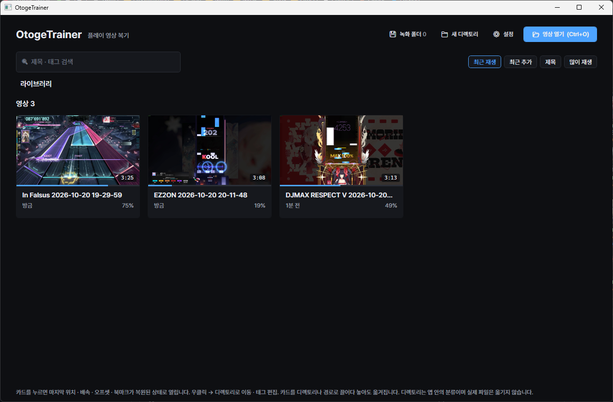
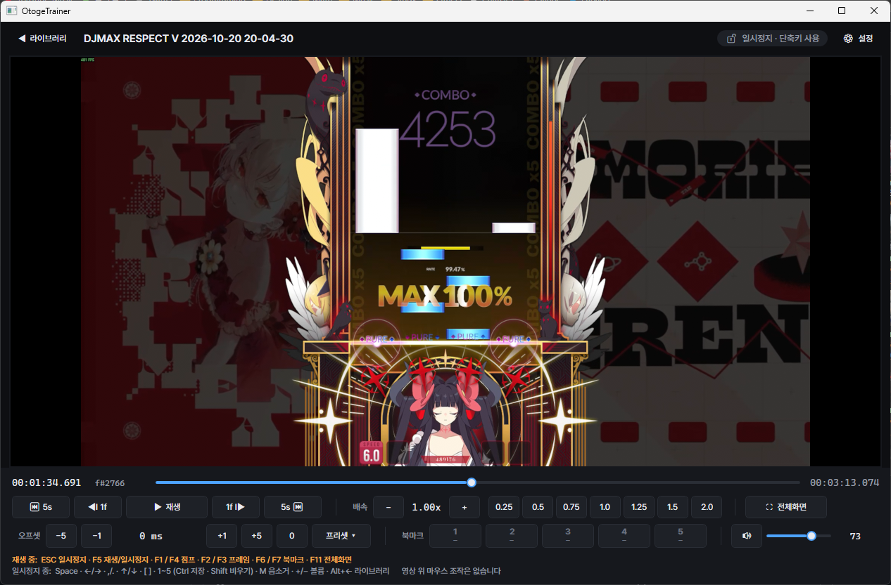
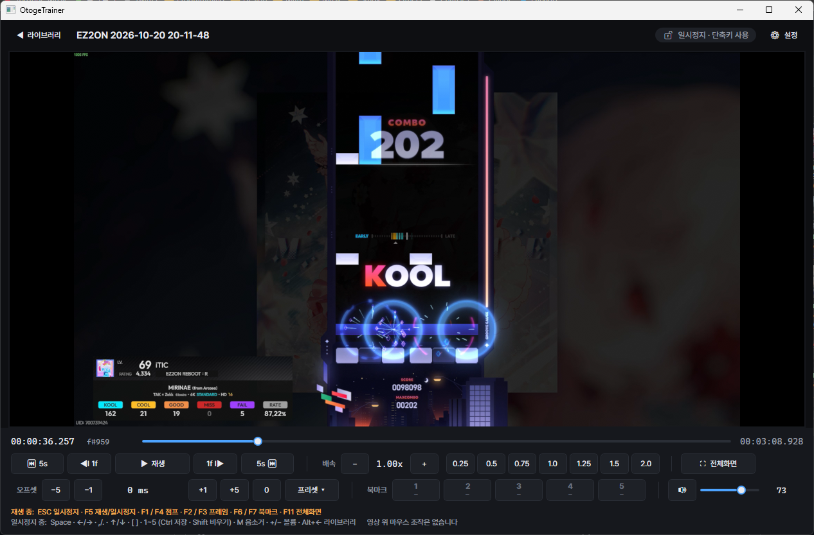
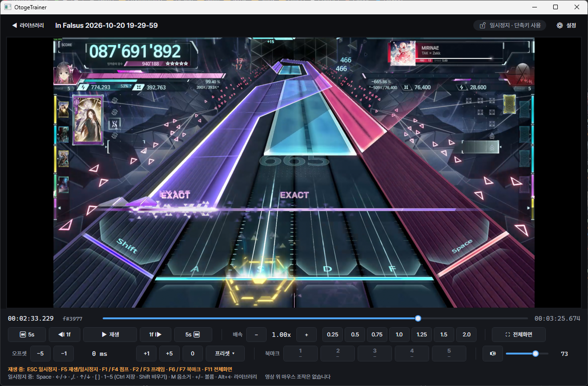

# OtogeTrainer

PC 리듬게임(音ゲー, otoge) 플레이어를 위한 **플레이 영상 복기 전용 로컬 영상 뷰어**입니다. Windows 데스크톱 앱.

녹화해 둔 자신의 플레이 영상이나 참고 영상을 프레임 단위로 뜯어보고, 느린 배속으로 따라 치며 연습하는 데 맞춰 만들었습니다.

> **개발 중** — 핵심 기능(M1)과 라이브러리 정리 기능(M2 일부)이 구현되어 있습니다. 배포 빌드는 [Releases](https://github.com/iTIC1721/OtogeTrainer/releases)에서 받을 수 있습니다.

<table>
  <tr>
    <td width="50%"><br><sub>라이브러리</sub></td>
    <td width="50%"><br><sub>DJMAX RESPECT V</sub></td>
  </tr>
  <tr>
    <td width="50%"><br><sub>EZ2ON REBOOT : R</sub></td>
    <td width="50%"><br><sub>In Falsus</sub></td>
  </tr>
</table>

## 일반 영상 플레이어와 다른 점

1. **프레임 단위 정밀 탐색이 기본 기능** — 프레임 스텝, 배속에 연동되는 점프, 영상별 북마크 5슬롯. 모든 탐색은 키프레임으로 튀지 않는 정확한 위치로 이동합니다.
2. **영상별 상태를 영구 기억** — A/V 오프셋, 배속, 마지막 재생 위치, 북마크를 영상마다 저장하고, 다시 열면 그대로 복원합니다. 파일을 옮겨도 파일 지문으로 같은 영상을 알아봅니다.
3. **재생 중에는 앱이 키 · 마우스에 반응하지 않음** — 손을 건반과 마우스에 올리고 영상을 따라 쳐도 재생이 멈추거나 튀지 않습니다. 재생 중에는 `ESC`(일시정지)와 지정한 **재생 중 동작 키**만 동작합니다.

## 주요 기능

### 재생 · 탐색

- 재생 / 일시정지, 타임라인 시크
- **프레임 단위 앞/뒤 이동** — 실행하면 항상 일시정지 상태가 됩니다
- **점프** — `5초 × 현재 배속`만큼 앞/뒤로 이동 (0.5배속이면 2.5초)
- **배속** — 프리셋 `0.25 / 0.5 / 0.75 / 1.0 / 1.25 / 1.5 / 2.0`, 0.05 단위 미세 조절 (0.10 ~ 4.00). 배속을 바꿔도 음정은 유지됩니다
- 현재 위치를 시각과 프레임 번호로 함께 표시
- 볼륨 · 음소거, 전체화면 (영상이 화면을 채우고 컨트롤은 떠 있는 바로 표시)

### 북마크

- 영상마다 **5개 슬롯**에 밀리초 단위 위치 저장 · 이동 · 비우기
- 재생 중에도 동작 키로 시간 순 이전 / 다음 북마크로 이동

### A/V 오프셋

- 영상별 **오디오 지연** 조절: −1000ms ~ +1000ms, 5ms 단위 (미세 1ms). 재생 중 바로 반영
- 양수 = 소리를 늦춤 (소리가 영상보다 빨리 들릴 때 올림). 프레임 수 환산값을 함께 표시
- **오프셋 프리셋** — 캡처 장치 · 게임별로 자주 쓰는 값에 이름을 붙여 두고 영상에 적용 (최대 8개)

### 재생 중 입력 차단

- 재생 중에는 `ESC`와 재생 중 동작 키를 뺀 **모든 키 입력과 영상 위 마우스 입력을 무시**합니다. 무시한 입력은 포커스 이동 · 메뉴 열림 같은 부작용도 일으키지 않습니다
- `ESC`는 일시정지 전용입니다. 플레이어를 닫지 않습니다
- 차단은 **이 앱 창이 포커스를 가진 동안에만** 적용됩니다. 시스템 전역 키보드 후킹을 쓰지 않으므로 다른 프로그램의 입력이나 `Win` · `Alt+Tab` 같은 Windows 기본 동작에는 관여하지 않습니다
- 다른 창으로 전환했다가 돌아오면 일시정지 상태에서 시작합니다

### 라이브러리

- 영상 열기 (파일 대화상자 / 드래그 앤 드롭). 지원 형식: `mp4, mkv, mov, avi, webm, ts, m2ts, flv, wmv`
- 썸네일 · 진행률 · 마지막 재생 시각이 표시되는 카드 목록. 누르면 마지막 상태가 복원된 채로 열립니다
- **녹화 폴더 등록** — 앱을 실행할 때 새 영상을 찾아 자동으로 추가합니다
- **디렉토리** — 실제 파일 위치와 무관한 앱 안의 중첩 분류. 카드를 끌어다 놓아 정리하며, 실제 파일은 옮기지 않습니다
- 제목 · 태그 검색, 태그 편집, 정렬 (최근 재생 / 최근 추가 / 제목 / 많이 재생)
- 목록에서 제거 (파일은 지우지 않음). 녹화 폴더의 영상은 제외 목록에 올라가 다시 추가되지 않습니다
- 파일이 사라진 영상은 "파일 없음"으로 표시합니다

## 단축키

### 재생 중 동작 키 (재생 · 일시정지 모두 동작)

설정에서 `ESC`를 뺀 아무 키로 바꾸거나 해제할 수 있습니다. 연습하는 게임의 키와 겹치면 다른 키로 바꾸세요.

| 기본 키 | 동작 |
|---|---|
| `ESC` | 일시정지 (변경 불가) |
| `F1` / `F4` | 뒤로 / 앞으로 점프 |
| `F2` / `F3` | 한 프레임 뒤로 / 앞으로 |
| `F5` | 재생 / 일시정지 |
| `F6` / `F7` | 이전 / 다음 북마크 |
| `F11` | 전체화면 |

### 일시정지 중

| 키 | 동작 |
|---|---|
| `Space` | 재생 / 일시정지 |
| `←` / `→` | 뒤로 / 앞으로 점프 |
| `,` / `.` 또는 `Shift+←` / `Shift+→` | 한 프레임 뒤로 / 앞으로 |
| `↑` / `↓` | 배속 ±0.05 |
| `Ctrl+↑` / `Ctrl+↓` | 배속 프리셋 위 / 아래 |
| `[` / `]` | 오프셋 −5ms / +5ms (`Ctrl`과 함께 ±1ms) |
| `Ctrl+Shift+0` | 오프셋 0 |
| `1`~`5` | 북마크 슬롯으로 이동 (`Ctrl` 저장 · `Shift` 비우기) |
| `M` / `+` / `−` | 음소거 / 볼륨 |
| `Alt+←` | 라이브러리로 돌아가기 |
| `Ctrl+O` | 영상 열기 (라이브러리 화면) |

## 설치

[Releases](https://github.com/iTIC1721/OtogeTrainer/releases)에서 둘 중 하나를 받으세요. 관리자 권한 · .NET 설치가 필요 없습니다.

- **설치 파일** `OtogeTrainer-<버전>-win-x64-setup.exe` — 실행하면 사용자 폴더(`%LOCALAPPDATA%\Programs\OtogeTrainer`)에 설치되고 시작 메뉴에 등록됩니다. 새 버전의 설치 파일을 실행하면 그대로 업데이트되고, 제거는 Windows 설정의 앱 목록에서 합니다.
- **포터블 zip** `OtogeTrainer-<버전>-win-x64.zip` — 원하는 폴더에 풀고 `OtogeTrainer.exe`를 실행하세요.

요구 사항: Windows 10 (1809 이상) / Windows 11, x64

라이브러리 · 설정은 프로그램과 따로 `%APPDATA%\OtogeTrainer\`에 저장되므로, 업데이트하거나 제거해도 지워지지 않습니다.

## 소스에서 빌드

필요한 것: [.NET 8 SDK](https://dotnet.microsoft.com/download/dotnet/8.0)

1. libmpv를 받습니다. 120MB라 저장소에 넣지 않았고, 스크립트가 고정된 빌드를 받아 해시를 확인한 뒤 `native/libmpv-2.dll`에 둡니다.

   ```bash
   powershell -ExecutionPolicy Bypass -File tools/fetch-libmpv.ps1
   ```

2. 빌드하고 실행합니다.

   ```bash
   dotnet build OtogeTrainer.sln
   dotnet run --project src/OtogeTrainer.App
   ```

라이브러리 DB · 설정 · 썸네일은 `%APPDATA%\OtogeTrainer\`에 저장됩니다. 실행 인자 `--data <폴더>`로 위치를 바꿀 수 있습니다.

## 테스트

```bash
# 단위 테스트
dotnet test OtogeTrainer.sln

# 검증용 클립 생성 (ffmpeg 필요, tests/assets/ 에 생성 · 커밋하지 않음)
bash tools/make-test-clips.sh

# 종단 검증 — 실제 창 · 재생 엔진 · 임시 DB로 사용자 시나리오 전체를 실행 (사용자 라이브러리는 건드리지 않음)
src/OtogeTrainer.App/bin/Debug/net8.0-windows/OtogeTrainer.exe --smoketest
```

`spike/OtogeTrainer.M0`는 재생 엔진 · 입력 차단 방식을 검증한 초기 스파이크입니다. `--selftest` · `--inputtest` · `--windowtest`로 회귀 확인에 씁니다.

## 배포

배포 zip(self-contained 단일 실행 파일 + libmpv + 라이선스 고지)은 `tools/publish.ps1`로 만듭니다. 결과는 `artifacts/release/`에 생깁니다.

```bash
powershell -ExecutionPolicy Bypass -File tools/publish.ps1 -Version 0.1.0
```

설치 파일은 그 결과로 `tools/build-installer.ps1`이 만듭니다. [Inno Setup 6](https://jrsoftware.org/isinfo.php)이 필요합니다(`winget install JRSoftware.InnoSetup`).

```bash
powershell -ExecutionPolicy Bypass -File tools/build-installer.ps1 -Version 0.1.0
```

`vX.Y.Z` 태그를 push하면 GitHub Actions(`.github/workflows/release.yml`)가 테스트를 돌린 뒤 같은 스크립트로 zip과 설치 파일을 만들어 Release에 올립니다. 함께 배포하는 libmpv의 대응 소스(`tools/bundle-libmpv-source.ps1`)도 같이 올립니다. 하이픈이 든 태그(`v0.2.0-beta.1`)는 프리릴리스가 됩니다.

## 프로젝트 구조

| 경로 | 내용 |
|---|---|
| `src/OtogeTrainer.App` | WPF 앱 — 라이브러리 · 플레이어 · 설정 화면 (MVVM) |
| `src/OtogeTrainer.Core` | 도메인 모델과 규칙 — 배속 · 점프 · 오프셋 계산, 파일 지문, 폴더 스캔 |
| `src/OtogeTrainer.Data` | SQLite 라이브러리 저장소 |
| `src/OtogeTrainer.Playback` | libmpv 기반 재생 엔진 (`IMediaEngine` 구현) |
| `src/OtogeTrainer.Input` | 재생 중 입력 차단 · 재생 중 동작 키 배치 |
| `tests/` | 단위 테스트 (xUnit) |
| `spike/` | M0 기술 검증 스파이크 |
| `installer/` | 설치 파일 스크립트 (Inno Setup) |
| `tools/` | libmpv 받기 · 배포 zip · 설치 파일 · libmpv 소스 묶기 · 검증 클립 생성 스크립트 |

## 기술 스택

- .NET 8 · WPF
- [libmpv](https://mpv.io/) — 재생 엔진
- [Microsoft.Data.Sqlite](https://www.nuget.org/packages/Microsoft.Data.Sqlite) — 라이브러리 DB
- [CommunityToolkit.Mvvm](https://www.nuget.org/packages/CommunityToolkit.Mvvm)

## 프라이버시

네트워크 통신을 하지 않습니다. 키 입력을 저장하거나 전송하지 않으며, 시스템 전역 키보드 후킹을 사용하지 않습니다.

## 라이선스

[GNU General Public License v3.0](LICENSE) (GPL-3.0-or-later).

재생 엔진으로 쓰는 libmpv 배포 빌드가 GPL 구성(x264 · x265 등 포함)이라, 앱도 GPL로 배포합니다. 함께 배포하는 구성요소의 라이선스와 대응 소스는 [THIRD-PARTY-NOTICES.md](THIRD-PARTY-NOTICES.md)를 보세요.
